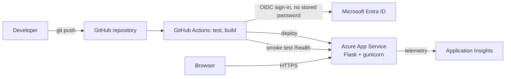

# Azure Cloud Project

A Python Flask web app deployed to **Azure App Service** with automated GitHub Actions deployments, secure OIDC sign-in to Azure, and monitoring through **Application Insights**.

**Live site:** `https://YOUR-APP-NAME.azurewebsites.net` (replace with your App Service URL)
**Health check:** `/health` &nbsp;|&nbsp; **Runtime info:** `/api/info`

## Architecture



## What's in the repo

| Path | Purpose |
|------|---------|
| `app.py` | Flask app: status page, `/health`, `/api/info`, security headers, optional Application Insights |
| `templates/`, `static/` | Status page HTML and CSS |
| `tests/` | pytest suite run on every push and pull request |
| `.github/workflows/main_ttscott-webapp.yml` | Test, deploy to App Service, then smoke test the live `/health` endpoint |
| `.github/workflows/codeql.yml` | Weekly and per-push CodeQL security scan |
| `.github/dependabot.yml` | Automatic update pull requests for Python packages and GitHub Actions |
| `scripts/harden-webapp.sh` | Azure CLI script that applies the App Service security settings below |
| `screenshots/` | Evidence from the Azure portal |

## Azure services used

- **Resource Group**: holds all project resources
- **App Service Plan and App Service**: Linux Python hosting
- **Application Insights**: request, failure and performance telemetry
- **Microsoft Entra ID**: federated identity (OIDC) that lets GitHub Actions deploy without a stored password
- **Managed Identity**: lets the app authenticate to other Azure services without secrets

## CI/CD pipeline

1. A push or pull request to `main` runs the tests.
2. Pull requests stop there. Nothing deploys from a pull request.
3. On `main`, the app is deployed to App Service using `azure/login` with OIDC.
4. A smoke test calls `/health` on the live site and fails the run if the new version isn't healthy.

## Security

**In the code**
- Security headers on every response: `Content-Security-Policy`, `Strict-Transport-Security`, `X-Frame-Options`, `X-Content-Type-Options`, `Referrer-Policy`, `Permissions-Policy`
- `/api/info` returns only non-sensitive details, with tests that check it doesn't leak configuration
- Dependencies pinned to patched versions, with Dependabot keeping them current
- CodeQL scanning for common vulnerabilities

**In Azure** (`scripts/harden-webapp.sh`, run it yourself after reading it)
- HTTPS only, TLS 1.2 minimum, HTTP/2 on
- FTP/FTPS disabled and basic-auth publishing turned off, so deployments go through Entra ID only
- System-assigned managed identity
- App Service health check pointed at `/health`
- Optional diagnostic logs sent to a Log Analytics workspace

## Run it locally

```bash
python -m venv .venv
source .venv/bin/activate        # Windows: .venv\Scripts\activate
pip install -r requirements-dev.txt
python -m pytest -q              # run the tests
python app.py                    # http://127.0.0.1:5000
```

## Monitoring

Application Insights is connected to the App Service. To also send telemetry from the Flask code itself (request traces, exceptions), set these App Service application settings:

- `APPLICATIONINSIGHTS_CONNECTION_STRING` (from the Application Insights resource)
- `ENABLE_AZURE_MONITOR` = `true`

Use either the portal's auto-instrumentation or this code-level option, not both, to avoid duplicate telemetry.

## Screenshots

| | |
|---|---|
|  |  |
|  |  |
|  | |

## Skills demonstrated

- Azure resource management (resource groups, App Service, App Service Plans)
- Web application hosting and configuration
- CI/CD with GitHub Actions, including OIDC federation to Azure
- Application monitoring with Application Insights
- Cloud security hardening (TLS, HTTPS-only, managed identity, secretless deployment)
- Automated testing and supply-chain hygiene (Dependabot, CodeQL)
- Troubleshooting service availability

## Lessons learned

This project gave hands-on experience deploying and managing a web application in Azure: cloud resource management, GitHub integration, application monitoring and troubleshooting service availability. Adding tests, a smoke test and security hardening showed how much of running a cloud app is about verifying it stays healthy and secure after it ships, not just getting it online.

## Next steps

- Define the infrastructure as code (Bicep or Terraform) so the whole environment can be rebuilt from the repo
- Add an Application Insights alert for failed requests and slow responses
- Move the App Service to Python 3.12 or newer (3.10 reached end of life in October 2026) and update the workflow to match
- Add a staging slot and swap for zero-downtime releases
